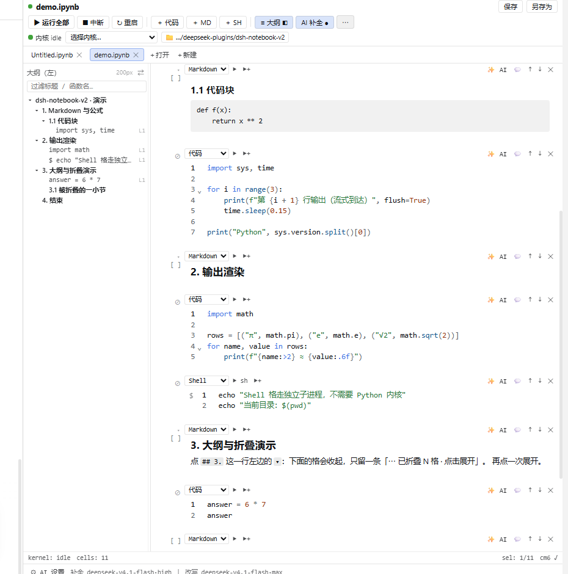
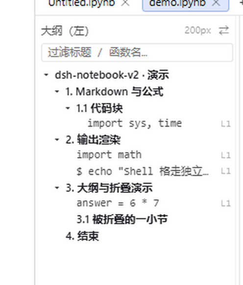

# dsh-notebook-v2

[中文](README.md) · **English**

A self-built Jupyter front-end plugin for **DeepSeek Harness**: a real notebook in the right sidebar —
persistent kernel, **streaming output**, multiple tabs, lossless `.ipynb` round-trip,
**inline AI edits and completions**, VS Code muscle memory.

`MIT` · `Node ≥ 20` · `DSH Desktop 0.2.1-rc.x`

## Screenshots



The outline pane is **resizable** (the width is remembered); the `▾` in a heading cell's gutter folds the whole section below it:



## Install

```bash
git clone https://github.com/LearnItHard/dsh-notebook-v2.git
cd dsh-notebook-v2
node scripts/install.mjs
```

Restart DeepSeek Harness (or reload the window) — **Notebook (v2)** shows up under the right sidebar's `+`.

- Other profile: `node scripts/install.mjs --profile <profile-dir>`
  (default `~/.dsh/profiles/desktop`; on Windows `%USERPROFILE%\.dsh\profiles\desktop`)
- Preview what it changes: add `--dry-run` · Remove: `node scripts/uninstall.mjs`
- The scripts are idempotent and back up the profile `package.json` before writing
- Python kernels need `ipykernel`; Shell cells work without any Python install
- To see everything below in action: open [`docs/demo/demo.ipynb`](docs/demo/demo.ipynb) and hit `▶ run all`

## What you get

**Toolbar**

| Row | Contents |
|---|---|
| 1 | sync dot · notebook title · `unsaved ●` · save · save as |
| 2 | ▶ run all · ■ interrupt · ↻ restart · ↻ restart & clear · clear outputs · ＋ code · ＋ MD · ＋ SH · ✕ delete · ≡ outline · AI completion |
| 3 | `kernel idle` dot · **kernel dropdown (conda envs; envs without `ipykernel` disabled)** · 📁 working dir (click to change) |
| Tabs | multiple notebook tabs · ＋open (inline path input) · ＋new |

**Cell types**: `Code` / `Markdown` / `Shell` / `Raw` (per-cell dropdown).
Markdown renders by default, click to edit. Shell cells run as a **separate subprocess**
(`cmd` / `bash` / `pwsh` auto-picked, no Python kernel needed). In `.ipynb` a Shell cell is the standard
Jupyter form — a code cell with a `%%bash` magic — so it stays valid in JupyterLab / VS Code.

**Output**: `print` streams line by line (ten thousand lines → **one** output block);
`text/html` (sandboxed iframe with height feedback), images, `application/json` foldable trees,
`text/latex` (KaTeX), markdown (tables / math / code / quotes); long output keeps “head 300 + tail 100 + expand”.

**Outline (TOC)**: `≡ 大纲` lists markdown headings (indented by level; `#` inside code blocks is not a heading)
plus each cell's first line; click to jump. The outline pane is **resizable** — drag its inner edge,
the width is remembered, double-click the splitter to reset to 200px, `←/→` to nudge.

**Markdown heading folding** (same behaviour as VS Code notebooks): a markdown cell whose
**first non-empty line is a heading** (`#`…`######`, or setext `===`/`---`) gets a `▾` in the gutter.
Collapsing hides every cell below it up to the **next heading of the same or higher level**, leaving a
`⋯ N cells collapsed · click to expand` placeholder. The heading cell itself stays visible; nesting follows
heading levels; jumping from the outline auto-expands the target section.

**AI completion**: `AI 补全` toggle (**off by default**, spends tokens). After ~0.5s of idle time a grey
continuation appears at the caret → `Tab` accepts, `Esc` discards, typing invalidates it.
Timeouts and failures stay silent.

**Inline AI edit (`Mod-K`)**: instruction → token stream → **line-level diff** review (`+N −M`) →
accept (`Mod-↵`) / accept & run / retry / reject (`Esc`). Uses the host's `ctx.llm.stream()`; provider/model
come from `config.ai` and are auto-resolved when left empty.

**Kernel**: persistent, variables live across cells; Interrupt / Restart / Restart-and-clear /
Restart-and-run-all; switch conda envs and change the working directory from the toolbar (both restart the kernel).

**Multiple notebooks**: several tabs per session, switching changes the active notebook; opening the same
path again only activates the existing tab.

**Lossless I/O**: reading then writing back is **semantically identical** — `attachments`, `metadata.widgets`,
`metadata.dsh` written by other plugins, and any unknown fields are preserved verbatim.

**Not planned** (v1 non-goals): ipywidgets interaction, debugger, remote / SLURM kernels, collaboration,
Monaco-grade type checking.

## Shortcuts

Editing (CodeMirror 6: search, folding, multi-cursor, bracket matching, completion, undo history):

`Shift-Enter` run & move down · `Ctrl(-Alt)-Enter` run · `Alt-Enter` run & insert below ·
`Mod-F` find · `Mod-S` save · `Mod-K` inline AI · `Tab` accept completion

Command mode (cell selected, not editing):

`Enter` edit · `↑↓` select · `Delete` delete cell · `Esc` leave editing

## Kernels and interpreters

The toolbar's kernel dropdown is **per session**; switching restarts the kernel. When you haven't picked one,
the interpreter is resolved in this order:

1. `config.python` (if set in `cordis.patch.yml`)
2. the interpreter selected by the `python-env` plugin for this session (inherited from the parent session)
3. scan local conda environments and pick the first one that **actually has `ipykernel`**
4. finally fall back to `python` on `PATH`

**Your env is missing from the dropdown**, or you get `No module named 'ipykernel'`: run
`pip install ipykernel` in that env, then pick it from the dropdown. **Python is optional** —
Shell cells run in their own subprocess.

Diagnostics: `curl http://127.0.0.1:<port>/nb2/diagnostics` lists candidate kernels, whether each has
`ipykernel`, and which one was chosen.

## Conflict with `@beihaizb/dsh-notebook`

`@beihaizb/dsh-notebook` is a **third-party** plugin (not part of this project, and this project does not
depend on it). Both register the **exact same `nb_*` tool names**, so enabling both at once registers
duplicate tools — **enable only one**. The scripts here only touch the profile's load list; they never modify
that plugin's files or any `.ipynb`.

```bash
node scripts/retire-old-plugin.mjs              # remove that plugin from the load list
node scripts/retire-old-plugin.mjs --rollback   # add it back
```

Both plugins can stay installed side by side; they just can't be enabled together.

## Docs

- Endpoint contract: [`docs/api-nb2.md`](docs/api-nb2.md) · sidecar protocol: [`docs/protocol-ndjson.md`](docs/protocol-ndjson.md)
- Plans: [requirement consolidation](docs/plans/2026-11-04-需求统一整理与实施计划.md) · [v6 UX fixes](docs/plans/2026-11-04-体验修复v6-计划.md)
- Review: [Phase 1–3 review notes](docs/phase1-3-review-brief.md)
- Research: [chat reference API](docs/research/2026-11-04-chat-reference-api.md) · [AI completion](docs/research/2026-11-04-ai-completion-survey.md) · [Jupyter shortcuts](docs/research/2026-11-04-jupyter-shortcuts.md)
- Developer / troubleshooting notes: [`AGENTS.md`](AGENTS.md)

## Development

```bash
node test/all.mjs          # every suite (includes a real ipykernel end-to-end test)
node test/all.mjs --fast   # skip the real-kernel suite
```

`lib/cm-vendor.js` (the bundled CodeMirror 6 + KaTeX) is committed — **users never build it**.
Rebuild with `node scripts/build-cm-vendor.mjs` only when changing dependencies or upgrading CM6.

## License

[MIT](LICENSE)
